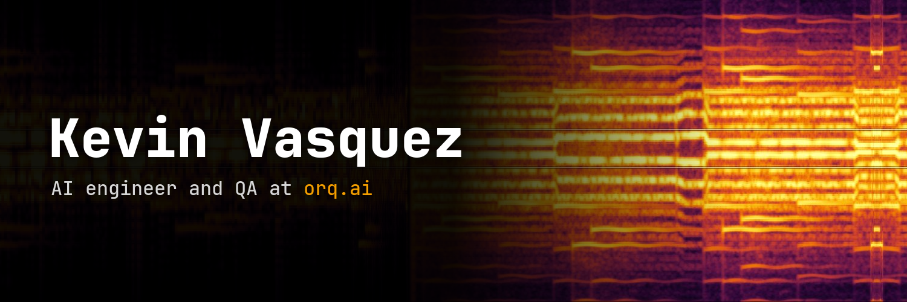
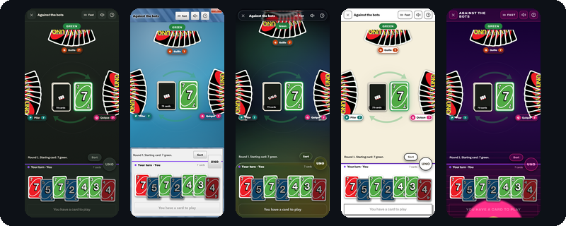
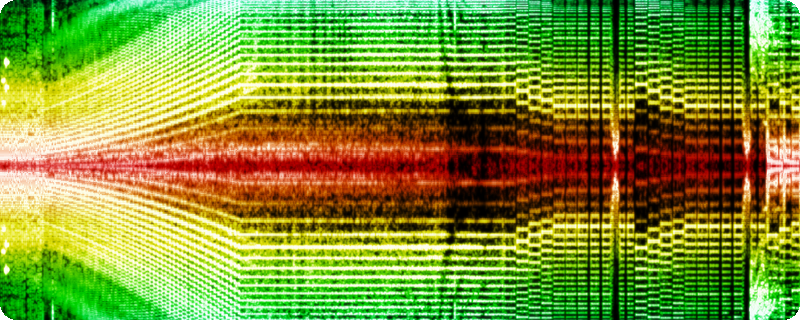
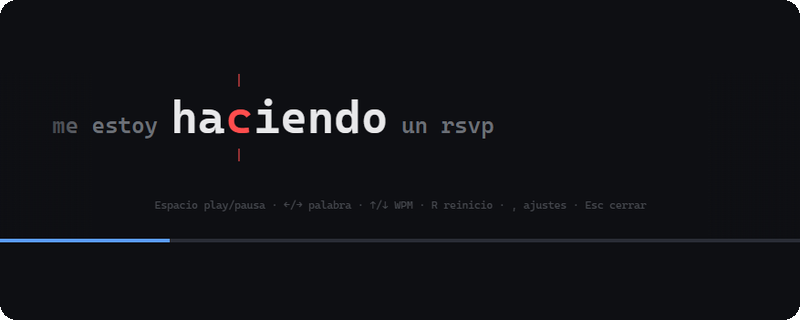
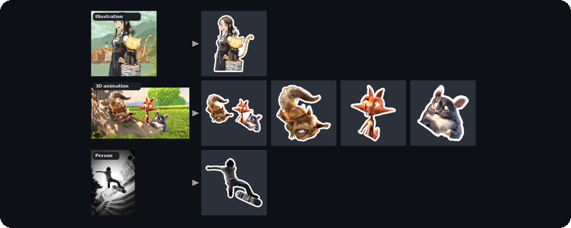

At home I build the tools I end up using every day.

  <picture>
    <source media="(prefers-color-scheme: dark)" srcset="assets/stack-dark.svg">
    
  </picture>

## Projects

<table>
<tr><td width="50%" valign="top"> <b>UNO</b> UNO as a web app, to play with friends. It works offline and speaks Spanish, English and Catalan.</td><td width="50%" valign="top"> <b>2D Spectrogram</b> A music visualizer for Wallpaper Engine that draws whatever is playing as a scrolling spectrogram. The header above is its output.</td></tr>
<tr><td width="50%" valign="top"> <b>RSVP reader</b> Select any text, press a hotkey and read it word by word, with the anchor letter fixed so your eyes stay still. I use it for long texts.</td><td width="50%" valign="top"> <b><a href="https://github.com/filep48/sticker-kit">sticker-kit</a></b> Turns screenshots into WhatsApp stickers by cutting out the real pixels, never redrawing them. One Python file that any AI chat with a code sandbox can run.</td></tr>
</table>

## More

<table>
<tr><td width="50%" valign="top"><b>ytget</b> A yt-dlp wrapper that does not give up on the first error. When a track fails it finds another copy and checks it by duration and title. On a 60 track playlist, plain yt-dlp gets 38 and this gets 59.</td><td width="50%" valign="top"><b>Social media analysis</b> A Claude Code skill that fetches what a YouTube, Instagram, TikTok or X post actually says, on screen and in the comments, and cites where every claim came from.</td></tr>
<tr><td width="50%" valign="top"><b>Reel finder</b> Describe a video you half remember, like "that clip of X doing Y", and it finds it for you.</td><td width="50%" valign="top"><b>AI-Brain</b> My notes as plain markdown on the cloud. Claude reads and writes it, I open it in Obsidian, and a weekly unattended check catches broken links, notes missing from the index and duplicate tags.</td></tr>
<tr><td width="50%" valign="top"><b>Look!</b> A wardrobe app that answers "what do I wear today?" from photos of your own clothes. Background removal runs on the phone, no server.</td><td width="50%" valign="top"><b>WebThemer</b> A browser extension that keeps the CSS you change in DevTools, so it is still there after a reload.</td></tr>
</table>

School projects, 2022 to 2024

 

- [VirtualVisionERP](https://github.com/filep48/VirtualVisionERP): ERP for virtual reality stores, Spring Boot and Spring Security. I led the team.
- [MushToolApp](https://github.com/filep48/MushToolApp): mushroom field guide for Android, Kotlin and Jetpack Compose.
- **SoundWaves** (now Lora): music streaming platform, Angular. Team of three.
- [JavaChat](https://github.com/filep48/JavaChat): chat app in plain Java.

